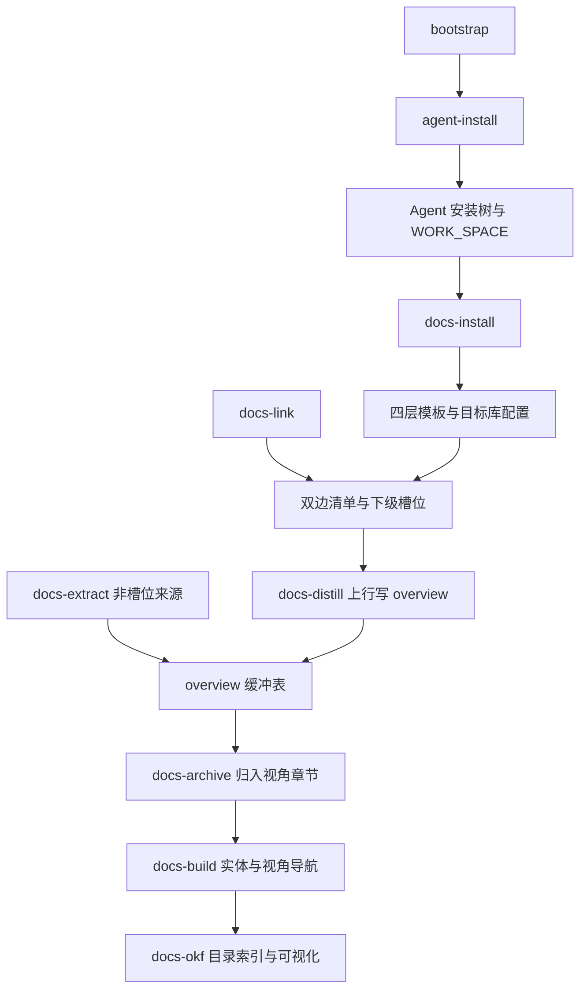
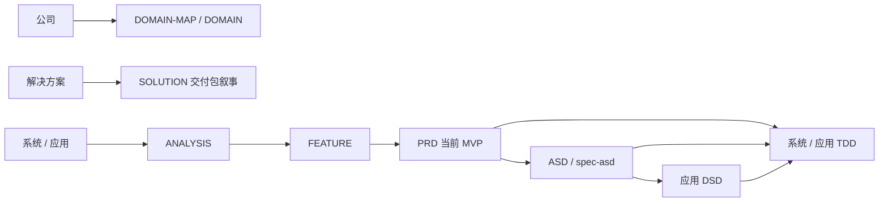

# ai-knowledge INDEX-GUIDE

> **最后更新**：2026-10-23
>
> **扫描**：`full` · `depth=3` · 全仓根单元；范围与阅读状态见第八章。
>
> **定位**：面向维护者与 Agent 的九章地图。先找职责与入口，再沿链接读取事实源；目录索引见 [index.md](index.md)。

---

## 一、项目概览（Project Overview）

### 1.1 速查表

| 需求 | 入口 | 职责 |
| --- | --- | --- |
| 项目概况与接入 | [README.md](README.md) · [quick-start.md](quick-start.md) | 四层知识库、安装与场景 A–D |
| 协作约定 | [AGENTS.md](AGENTS.md) | 角色、必读顺序、写入与提交边界 |
| 公司知识库 | [company/README.md](company/README.md) · [设计](company/DESIGN.md) | 企业架构、域总图与解决方案槽位 |
| 解决方案知识库 | [solution/README.md](solution/README.md) · [设计](solution/DESIGN.md) | 产品服务与系统组合、交付包叙事 |
| 系统知识库 | [system/README.md](system/README.md) · [设计](system/DESIGN.md) | 业务与产品细化、应用及数据概设 |
| 应用知识库 | [application/README.md](application/README.md) · [设计](application/DESIGN.md) | API、物理表、中间件与组件实现知识 |
| Agent 资源 | [agent/README.md](agent/README.md) · [Skill 清单](agent/skills/README.md) | 知识语义、协作协议、规范与工作流 |
| 安装编排 | [bootstrap.sh](bootstrap.sh) | 先安装 Agent，再初始化知识库；支持复用元库 |
| 共享脚本与回归 | [agent/scripts/README.md](agent/scripts/README.md) | 配置、文件操作、联邦清单、校验与测试入口 |
| 索引基线 | [§8.3 维护规则](#83-维护规则) | 本指南正文中的完成时间锚点 |

### 1.2 元信息

| 项 | 已核实内容 |
| --- | --- |
| 项目 | `ai-knowledge`，四层知识库模板与 Agent 协作资源元库 |
| 运行形态 | Markdown/YAML 文档及 Bash/Python 工具；没有业务应用服务运行时 |
| 主要依赖 | 安装与共享库要求 Bash 5+、Git；Python 用于索引、OKF 与校验；其他依赖按入口检查 |
| 本轮规模 | Git 跟踪 1,659 文件；工作树另有 4 份未跟踪源码/测试。统计与阅读口径见 §8.1 |
| 模板版本 | 四层 `DESIGN.md` 均为 `2026.1020.1`；发布与升级规则见 §5.4 |
| 本机配置 | `.docsconfig` 的 `DOC_DIR=company`、`KNOWLEDGE_TYPE=meta`；本轮显式选择仓库根地图，不使用默认输出位置 |
| 当前内容性质 | 四层包含 `EXAMPLE` 实体与阶段模板；示例不代表已实现的业务、部署或真实联邦 |

---

## 二、架构视图（Architecture View）

### 2.1 模块结构

```text
./
├── README.md / AGENTS.md / INDEX-GUIDE.md / index.md / quick-start.md
├── TODO-LIST.md
├── bootstrap.sh
├── company/
│   ├── DESIGN.md / knowledge/（含 overview/）
│   └── domains/ / adr/ / solution-slots/
├── solution/
│   ├── DESIGN.md / knowledge/（含 overview/）
│   └── solutions/ / adr/ / system-slots/
├── system/
│   ├── DESIGN.md / knowledge/（含 overview/）
│   └── analysis/ / features/ / requirements/ / adr/ / application-slots/
├── application/
│   ├── DESIGN.md / knowledge/（含 overview/）
│   └── analysis/ / features/ / requirements/ / adr/
├── agent/
│   ├── knowledge/              # 知识语义与格式
│   ├── references/             # 协作协议
│   ├── rules/                  # 通用及目标工程规范
│   ├── skills/                 # 25 个 Skill；各自含引用、脚本、评测或测试
│   ├── scripts/                # 共享库、tools/ 与 tests/
│   ├── cli/docs/               # 宝盒 CLI 设计与计划，尚非已实现命令
│   └── hooks.json / hooks/     # preToolUse 为空
├── docs/                       # 本地会话工作稿；不作为本轮事实源
├── .docsconfig
└── .githooks/pre-commit
```

四层均有 `knowledge-links.yaml`、目录索引、九章指南和生成的 `viz.html`。三个槽位根当前只有说明与索引页，无下级软链。评测运行目录另列 §8.2，不计为 Skill。

### 2.2 依赖关系



模块依赖为 Skill 编排、共享入口、职责实现、路径与日志基础能力；测试设施可调用生产模块，生产模块不依赖测试。具体边界见 [共享脚本说明](agent/scripts/README.md)。

### 2.3 包结构

本仓以目录职责代替应用包分层。

| 目录/入口 | 职责 |
| --- | --- |
| [agent/knowledge/](agent/knowledge/README.md) | 首次定义层、实体关系、字段、联邦配置与 OKF 格式 |
| [agent/references/](agent/references/README.md) | 布局、意图澄清、单元推进、烤干、受众与待办协议 |
| [agent/rules/](agent/rules/CONVENTIONS.md) | 仓库约定；Java、Maven、DDD 等供目标工程按需使用 |
| [agent/skills/](agent/skills/README.md) | 各 Skill 的工作流、门禁、脚本与验证材料 |
| [docs-core.sh](agent/scripts/docs-core.sh) | 公共 Bash 库聚合入口；职责实现位于 `agent/scripts/lib/` |
| [docsconfig.sh](agent/scripts/lib/docsconfig.sh) | 轻量配置入口，加载字段、工作区和持久化模块 |
| [knowledge-links.sh](agent/scripts/lib/knowledge-links.sh) | 清单路径与 YAML 编解码入口 |
| [test-core.sh](agent/scripts/test-core.sh) | 测试断言与运行器兼容入口 |

### 2.4 文档目录

| 范围 | 目录索引 | 九章地图 | 稳定知识与阶段产物 |
| --- | --- | --- | --- |
| 根仓库 | [index.md](index.md) | 本文件 | 元库入口与工具导航 |
| 公司 | [company/index.md](company/index.md) | [company/INDEX-GUIDE.md](company/INDEX-GUIDE.md) | `knowledge/`、`domains/`、`adr/` |
| 解决方案 | [solution/index.md](solution/index.md) | [solution/INDEX-GUIDE.md](solution/INDEX-GUIDE.md) | `knowledge/`、`solutions/`、`adr/` |
| 系统 | [system/index.md](system/index.md) | [system/INDEX-GUIDE.md](system/INDEX-GUIDE.md) | `knowledge/`、`analysis/`、`features/`、`requirements/`、`adr/` |
| 应用 | [application/index.md](application/index.md) | [application/INDEX-GUIDE.md](application/INDEX-GUIDE.md) | 同系统阶段目录；实体首次定义范围不同 |

物理路径以 [knowledge-layout.md](agent/references/knowledge-layout.md) 为准；会话稿路径由 [session-spec-path.md](agent/references/session-spec-path.md) 解析。本轮不刷新子层指南、目录索引或实体导航块。

---

## 三、接口清单（Interface Catalog）

### 3.1 服务接口

[未索引：不适用] 没有业务 RPC/Dubbo/gRPC 服务。可执行契约为 CLI 与辅助脚本，见 §3.5；实体样例中的服务名称不等于运行服务。

### 3.2 HTTP 接口

[未索引：不适用] 没有对外 REST 路由实现。`API-EXAMPLE.md` 为知识模板；[refresh-codex.sh](agent/scripts/refresh-codex.sh) 调用既有代理的 `/v1/models`，属于外部依赖，不是本仓提供的端点。

### 3.3 定时任务

[未索引：业务调度不适用] 本仓提供 [codex-daemon-watch.py](agent/scripts/codex-daemon-watch.py) 本地工具：轮询托管守护进程身份；首次观察仅建基线，后续实例变化时正常退出并重开已运行的桌面应用。用户级 LaunchAgent 的安装说明见 [共享脚本说明](agent/scripts/README.md)；本轮只读源码，不代表该服务已安装或正在运行。

### 3.4 消息队列

[未索引：不适用] 没有消息生产者、消费者或 Topic 实现；设计规范和模板中的消息描述属于目标工程资料。

### 3.5 CLI / Slash 入口

| 能力 | 入口 | 作用与边界 |
| --- | --- | --- |
| 安装编排 | [bootstrap.sh](bootstrap.sh) | `--components=docs\|agent\|both`；`both` 先 Agent 后知识库；`--meta` 复用元库 |
| Agent 安装 | [agent-install.sh](agent/skills/agent-install/scripts/agent-install.sh) | Agent 实体树写入家目录 `.agents`；`--target` 决定 IDE 链接位置；推断工作区与全局值冲突时，实跑在写入前停止 |
| 知识库初始化 | [docs-install.sh](agent/skills/docs-install/scripts/docs-install.sh) | `knowledge` 安装模板；`config` 只重写配置；不向目标复制建联脚本 |
| 联邦维护 | [docs-link.sh](agent/skills/docs-link/scripts/docs-link.sh) | `--link`、`--unlink`、`--check`、`--repair`；不承担 Git 内容更新 |
| 模板升级 | [docs-upgrade.sh](agent/skills/docs-upgrade/scripts/docs-upgrade.sh) | 整树升级按版本/发布快照比较；指定路径对齐由 Agent 按 Skill 处理 |
| 版本发布 | [docs-publish/SKILL.md](agent/skills/docs-publish/SKILL.md) | 四层版本、发布预览与确认后的 Git 发布链 |
| 九章索引辅助 | [indexing.sh](agent/skills/docs-indexing/scripts/indexing.sh) | 只枚举 `DOC_DIR` 候选；`--output` 不改变扫描根；不代替正文阅读 |
| 锚点读写 | [indexing_log.py](agent/skills/docs-indexing/scripts/indexing_log.py) | `read-baseline` / `write-anchor`；仅正文验证成功后推进锚点 |
| 实体导航 | [generate_knowledge_index.py](agent/skills/docs-build/scripts/generate_knowledge_index.py) | 维护第四章受管导航块；实体提取由 Agent 完成 |
| OKF | [docs-okf/SKILL.md](agent/skills/docs-okf/SKILL.md) | `refresh` / `validate` / `viz`；配置与执行入口见该 Skill |
| Markdown 链接 | [validate-link-reachable.sh](agent/scripts/tools/validate-link-reachable.sh) | 检查 Agent Markdown 本地链接与跨目录边界 |
| 引用隔离 | [forbidden-ref-outer.sh](agent/scripts/tools/forbidden-ref-outer.sh) | 检查库外具名会话稿引用；区分违规与工具错误 |
| 测试聚合 | [tests/run.sh](agent/scripts/tests/run.sh) | `--quick`、`--full`、`--suite`；浏览器套件需显式选择及现有依赖 |
| 本地桌面工具 | [refresh-codex.sh](agent/scripts/refresh-codex.sh) · [监控器](agent/scripts/codex-daemon-watch.py) | 刷新脚本默认刷新目录并重开桌面应用，`--catalog-only` 跳过重开；监控器在守护进程实例变化时重开桌面；本轮未执行 |

所有 Slash 名称见 §9.3；预览与确认按各 Skill 的入口契约执行，不代表对应底层 CLI 默认只读。

---

## 四、领域模型（Domain Model）

### 4.1 业务术语

| 术语 | 定义 | 事实源 |
| --- | --- | --- |
| SSOT | 实体只在规定层首次定义，其他层通过 ID 引用 | [knowledge-governance.md](agent/knowledge/knowledge-governance.md) |
| 五视角 | 业务、产品、应用、数据、技术；各层承载粒度不同 | [glossary.md](agent/knowledge/glossary.md) |
| 联邦 | 应用→系统→解决方案→公司；每个下级最多一个直接父级 | [federation-config.md](agent/knowledge/federation-config.md) |
| overview | 已核实内容进入章节前的缓冲表；第三列承接提炼结果 | [overview-spec.md](agent/knowledge/overview-spec.md) |
| SDD | 按层、按已共识上游推进需求与设计产物 | [Skill 清单](agent/skills/README.md) |
| OKF | Markdown 实体、元数据、关系和渐进披露索引格式 | [okf-spec.md](agent/knowledge/okf-spec.md) |

### 4.2 聚合根（知识组织）

下表导航到各层首次定义范围；父级 ID 用作目录宿主，不代表在本层复制实体定义。

| 层 | 首次定义的实体 | 入口 |
| --- | --- | --- |
| 公司 | VC、BD、BSD-L1、CAP、BL、TPL | [company/knowledge/README.md](company/knowledge/README.md) |
| 解决方案 | SLN、PL、PD、BP、BSP、BSD-L2、BS、MDG、TS | [solution/knowledge/README.md](solution/knowledge/README.md) |
| 系统 | SYS、APP、MS、BSD-L3、BC、AGG、AB、PM、FT、FR、UC、BR、DS、ENT | [system/knowledge/README.md](system/knowledge/README.md) |
| 应用 | API、TBL、MW、CMP | [application/knowledge/README.md](application/knowledge/README.md) |

### 4.3 领域服务（协作能力）

| 能力 | 职责 | 入口 |
| --- | --- | --- |
| 知识治理 | 层级、实体关系、引用及字段约束 | [agent/knowledge/README.md](agent/knowledge/README.md) |
| 知识构建 | 非槽位提炼、槽位上行、归档、实体化与导航 | [workflow-routing.md](agent/references/workflow-routing.md) |
| 需求交付 | 公司域图、方案叙事、需求分析至测试设计 | [agent/skills/README.md](agent/skills/README.md) |
| 安装与维护 | 初始化、联邦建联、模板升级、发布及生态技能更新 | [§3.5 CLI / Slash 入口](#35-cli--slash-入口) |

### 4.4 领域事件

[未索引：业务事件不适用] 文档变更由 Git 溯源；索引完成时间写入对应指南的 HTML 注释；未闭合工作记入 [TODO-LIST.md](TODO-LIST.md)。这些记录不构成运行时事件系统。

---

## 五、业务逻辑（Business Logic）

### 5.1 状态流转（SDD 阶段）



图表示产物依赖，不要求每次执行全部流程。TDD 面向系统或应用；缺少 DSD 时，可确认仅设计 PRD 支持的业务行为用例，不补造接口细节。中央 ASD/spec-asd 由应用侧只读消费；来源与内容基线先确认，见 [central-spec-source.md](agent/skills/sdx-design/references/central-spec-source.md)。

### 5.2 核心流程

| 场景 | 流程与关键条件 |
| --- | --- |
| 全新安装 | `bootstrap --components=both` 先建立 Agent 树与工作区，再初始化知识库；已有元库显式传 `--meta` |
| 知识建联 | `docs-link` 双边登记及槽位维护；内容更新遵循各仓 Git 工作流 |
| 内容归档 | 非槽位来源用 `docs-extract`；下级槽位用 `docs-distill`；核实 overview 后由 `docs-archive` 写目标章节 |
| 实体与索引 | `docs-build` 管实体和第四章导航；`docs-indexing` 管九章指南；`docs-okf` 管目录索引和可视化 |
| 模板更新 | `docs-upgrade` 按模板结构保留业务正文，根级 `DESIGN.md` 为整文件覆盖特例；重填、未落位处置与校核完成后才推进版本；发布由 `docs-publish` 管理 |
| 生态技能更新 | `skill-upgrade` 更新有源生态 skills；本仓 Agent 树更新归 `agent-install` |

### 5.3 业务规则（协作）

| 规则来源 | 约束 |
| --- | --- |
| [AGENTS.md](AGENTS.md) | 先读后写、最小变更、未核实事实不写成结论；提交须确认 |
| [CONVENTIONS.md](agent/rules/CONVENTIONS.md) | 文件引用、产物门禁与会话稿引用隔离 |
| [intent-clarify.md](agent/references/intent-clarify.md) · [unit-cycle-protocol.md](agent/references/unit-cycle-protocol.md) | 当前单元写前确认，复用已有明确授权；写后验证与用户动作 |
| [grilling-skill.md](agent/references/grilling-skill.md) · [audience-and-language.md](agent/references/audience-and-language.md) | 烤干与受众质检 |
| [entity-relations.md](agent/knowledge/entity-relations.md) | 关系方向与允许边；禁止凭目录层级臆造实体关系 |

### 5.4 枚举与模式

| 项 | 取值或规则 | 事实源 |
| --- | --- | --- |
| 知识库初始化 | `standalone` / `central`；后者仅应用层；`scope=knowledge\|config` | [docs-install 参数](agent/skills/docs-install/references/parameters.md) |
| 索引 | `full` / `incremental`；深度 `1/2/3`；3 要求范围内文本全文读取 | [scan-spec.md](agent/skills/docs-indexing/references/scan-spec.md) |
| 联邦清单类型 | `parent` / `child` / `meta`；meta 表示模板来源，不等于父级 | [federation-config.md](agent/knowledge/federation-config.md) |
| 模板版本 | `YYYY.MMdd.patch`；四层一致，同日递增 patch | [docs-publish 版本规则](agent/skills/docs-publish/references/versioning.md) |
| 协作流程 | 语义族、轻流程与各技能特例，按路由表及本地门禁执行 | [workflow-routing.md](agent/references/workflow-routing.md) |

---

## 六、数据映射（Data Mapping）

### 6.1 数据源

| 数据源 | 形态 | 职责 |
| --- | --- | --- |
| `{ID}.md` | Markdown 与 YAML frontmatter | 实体定义及关系；格式见 [OKF 规范](agent/knowledge/okf-spec.md) |
| 视角元模型 | [agent/knowledge/](agent/knowledge/README.md) 中五份 `*-meta.md` | 各视角字段与必填项 |
| `knowledge-links.yaml` | 受约束的 YAML 清单 | 本地仓库路径、Git 来源、文档目录与建联类型 |
| `knowledge/overview/NAME-overview.md` | 表格模板 | 各层内容缓冲；当前均为占位 |
| `index.md` / `viz.html` | 导航与生成 HTML | 渐进披露与实体图；不替代实体事实源 |
| Git | 跟踪文件及历史 | 内容版本与变更溯源 |

### 6.2 实体映射（应用演示链）

| 样例 | 落点 | 含义 |
| --- | --- | --- |
| API | [API-EXAMPLE.md](application/knowledge/application/MS-EXAMPLE/API-EXAMPLE.md) | 以系统层 MS 为宿主的接口知识 |
| TBL | [TBL-EXAMPLE.md](application/knowledge/data/ENT-EXAMPLE/TBL-EXAMPLE.md) | 以系统层 ENT 为宿主的物理表知识 |
| MW / CMP | [MW-EXAMPLE.md](application/knowledge/technical/MW-EXAMPLE/MW-EXAMPLE.md) · [CMP-EXAMPLE.md](application/knowledge/technical/MW-EXAMPLE/CMP-EXAMPLE.md) | 中间件与组件实现样例 |

这些文件用于展示字段和关系，不证明真实路由、DDL、依赖坐标或部署。其他层实体通过 §4.2 的知识入口下钻。

### 6.3 关系映射

实体通过 `parent/children`、`implements_to/implemented_by`、`maps_to/mapped_by` 等规定关系连接；允许边与例外见 [entity-relations.md](agent/knowledge/entity-relations.md)。同层用 bundle-relative 链接；跨层 ID、上层 HTTP 引用边界见 [knowledge-reference-rules.md](agent/knowledge/knowledge-reference-rules.md)。

联邦清单 `path` 使用字面量 `${WORK_SPACE}/…`，按清单所属库配置展开；`repository` 保存 Git 远端，`dir` 保存文档子目录。字段、标量与写入保障见 [federation-config.md](agent/knowledge/federation-config.md)。

### 6.4 SQL 索引

[未索引：业务 SQL 不适用] 没有业务数据库 DDL 或 SQL 索引。模型目录刷新工具可只读查询既有 CC Switch SQLite 请求记录判断空闲，不是本仓数据库服务。

---

## 七、配置中心（Configuration Hub）

### 7.1 配置项

| 配置 | 位置 | 用途 |
| --- | --- | --- |
| `AGENT_ROOT` / `AGENT_DIR` | [.docsconfig](.docsconfig) | 当前为 `~` / `.agents`，定位安装树 |
| `REPO_DIR` / `DOC_DIR` / `KNOWLEDGE_TYPE` | [.docsconfig](.docsconfig) | 当前为 `ai-knowledge` / `company` / `meta`；与本轮显式输出范围区分 |
| `WORK_SPACE` | Agent 安装树 `configs` | 工作区根；配置解析器读取，不以环境变量替代 |
| `GIT_REPO_URL` / `GIT_REF` | [bootstrap.sh](bootstrap.sh) | 来源仓库和克隆引用；显式 `--meta` 可复用本地元库 |
| 联邦来源 | 四层 `knowledge-links.yaml` | 当前各有一条 `meta`，没有有效 `parent/child` 登记 |
| 工具钩子 | [agent/hooks.json](agent/hooks.json) · [.githooks/pre-commit](.githooks/pre-commit) | 前者 `preToolUse=[]`；后者调用引用隔离扫描器；不推断 Git 已启用该钩子 |
| OKF 路径 | [path-resolution.md](agent/skills/docs-okf/references/path-resolution.md) | 完整配置、Agent 树、bundle 与输出解析规则 |
| 本地刷新工具 | [refresh-codex.sh](agent/scripts/refresh-codex.sh) | `CODEX_HOME`、`CC_SWITCH_HOME`、代理地址与等待参数；不属于知识库配置 |

### 7.2 环境差异

| 场景 | 差异 |
| --- | --- |
| `knowledge + standalone` | 安装选定层模板，写配置与元库来源登记 |
| `knowledge + central` | 仅应用层支持，复制范围由安装器定义，中央概设只读消费 |
| `scope=config` | 只重写 `.docsconfig`，不创建知识库目录；移除旧 `KNOWLEDGE_TYPE` |
| 元库源码与安装副本 | 元库源码可识别本仓来源；已安装副本执行 knowledge 安装须显式 `--meta` |
| 本地脚本环境 | 安装与公共库需要 Bash 5+；macOS 自带 Bash 3.2 不满足；具体工具额外依赖按入口检查 |

### 7.3 敏感信息

本指南只记录配置键、仓内路径与必要的非秘密值，不读取或记录凭据。当前 `.docsconfig` 已被 Git 跟踪，根目录没有 `.gitignore`；不能沿用旧指南“点文件一律忽略、配置不入库”的描述。

---

## 八、索引边界（Index Boundary）

### 8.1 覆盖范围

本轮全量读取当前工作树，包括已提交、未暂存及未跟踪文本；不以旧索引统计作为阅读证据。根输出与 `DOC_DIR=company` 分开处理，未将脚本对公司库的候选统计冒充全仓覆盖。

| 顶层 | Git 跟踪数 |
| --- | ---: |
| `agent/` | 1,367 |
| `application/` | 58 |
| `system/` | 94 |
| `solution/` | 63 |
| `company/` | 68 |
| 根文件 | 8 |
| `.githooks/` | 1 |
| **合计** | **1,659** |

跟踪集另加未跟踪的监控器及三份测试，共 1,663 个候选文件；扣除 §8.2 的 602 个生成产物后，精读范围为 **1,061** 文件。文件类型为 Markdown 673、Shell 252、JSON 57、Python 56、YAML 18、文本/CJS/AWK 各 1、无扩展名配置/钩子 2。

**阅读状态**：范围内 **1,061 / 1,061 文件全文已读**，部分阅读与未读均为 0；分区账本已合并核对。扫描期间新增与修改文件已补读，收尾 SHA-256 复核无未覆盖变化。目标指南九章结构、25 个 Skill 入口及 138 个本地链接检查通过；本轮未执行业务脚本或测试套件。

### 8.2 排除列表与边界

| 范围 | 原因 |
| --- | --- |
| `agent/skills/docs-archive-workspace/live-20261022-172841/`、`live-20261022-182533-v4/` | 598 个评测运行产物；不作为当前工作流定义；Skill 的评测规格、源码和测试仍纳入精读 |
| 四层 `viz.html` | 4 个生成文件；读取生成器与测试，不以旧图证明实体状态 |
| Git 元数据、忽略项、本地会话稿、缓存、依赖与构建目录 | 不作本轮知识事实源；本机 `docs/` 存在，不能写成缺席 |
| 外部软链目标、用户安装树与外部仓库 | 不跨库扫描，不以本地模板证明实际部署或联邦状态 |

`agent/cli/docs/` 已作为设计资料读取；其中命令与代码属于计划，不列为已实现 CLI。四层实体、overview 和阶段模板均按样例读取。读取测试源码不等于执行测试；本轮验证范围仅为目标索引。

本轮只维护根指南。已发现的其他文档历史问题包括子层指南的旧锚点伪链接、系统业务入口的实体宿主路径、解决方案 overview 的章节锚点，以及部分入口对配置与索引职责的旧描述；这些文件未在本轮改写，不能据本轮结果宣称全仓链接无误。

### 8.3 维护规则

- **触发**：目录、Skill、脚本契约、配置或实体层级变化后更新对应地图。
- **完成基线**：本指南正文 HTML 注释 `sdx-indexing:indexing_finished_ms`；不是独立日志文件。全量无 since；后续增量优先显式 since，否则读取正文有效锚点。
- **增量来源**：基线后第一父链提交、暂存、未暂存和未跟踪四类；重命名同时检查旧新路径，删除更新导航。
- **收尾**：复查阅读期间文件变化，补读后验证；未完成时保留原锚点。候选扫描或运行块刷新不算完成。
- **产物分工**：子层指南各自维护锚点；`docs-build` 实体块保留；OKF 刷新另由 `docs-okf` 承接。

---

## 九、扩展资源（Extended Resources）

### 9.1 核心文档

| 查阅问题 | 事实源 |
| --- | --- |
| 四层边界与首次定义 | [knowledge-governance.md](agent/knowledge/knowledge-governance.md) |
| 实体类型与统一语言 | [glossary.md](agent/knowledge/glossary.md) |
| 关系动词、方向与允许边 | [entity-relations.md](agent/knowledge/entity-relations.md) |
| 同层、跨层与外源引用 | [knowledge-reference-rules.md](agent/knowledge/knowledge-reference-rules.md) |
| 联邦路径与 HTTP 展示 | [federation-config.md](agent/knowledge/federation-config.md) |
| overview 表格与内容归档 | [overview-spec.md](agent/knowledge/overview-spec.md) |
| OKF 格式与字段 | [okf-spec.md](agent/knowledge/okf-spec.md) |
| 目录、阶段与槽位路径 | [knowledge-layout.md](agent/references/knowledge-layout.md) |
| 协作协议与技能路由 | [references/README.md](agent/references/README.md) · [workflow-routing.md](agent/references/workflow-routing.md) |
| 文档分类 | [document-guidelines.md](agent/rules/document/document-guidelines.md) |
| 未闭合待办 | [TODO-LIST.md](TODO-LIST.md) · [todo-protocol.md](agent/references/todo-protocol.md) |

### 9.2 相关项目

| 项目 | 关系 |
| --- | --- |
| `oleewen/ai-knowledge` | 元库来源；下游按安装与升级契约消费模板 |
| 使用本模板的目标工程 | 通过 `.docsconfig`、元库来源与联邦登记建立关系；当前模板不能证明具体工程已接入 |
| 本机 Agent 安装树 | 由 `agent-install` 管理；本轮未修改或同步安装资源 |

### 9.3 工具链与 Skill 清单

| 工具 | 用途 |
| --- | --- |
| Bash 5+ / Git | 安装、配置、联邦与版本操作 |
| Python 3 | 索引、OKF、文档校验与辅助工具；最低版本按具体脚本要求 |
| `rg` / `rsync` / `curl` | 检索、可选同步与网络获取；依赖以各入口检查为准 |
| Node / Playwright / 浏览器 | 显式 OKF 浏览器测试；普通索引更新不依赖 |

以下为当前 **25** 个 Skill 的路径索引；用途和协议绑定见 [Skill 清单](agent/skills/README.md) 与各 `SKILL.md`。

| 命令 | 目录 |
| --- | --- |
| `/agent-install` | [agent/skills/agent-install/SKILL.md](agent/skills/agent-install/SKILL.md) |
| `/docs-agent` | [agent/skills/docs-agent/SKILL.md](agent/skills/docs-agent/SKILL.md) |
| `/docs-archive` | [agent/skills/docs-archive/SKILL.md](agent/skills/docs-archive/SKILL.md) |
| `/docs-build` | [agent/skills/docs-build/SKILL.md](agent/skills/docs-build/SKILL.md) |
| `/docs-distill` | [agent/skills/docs-distill/SKILL.md](agent/skills/docs-distill/SKILL.md) |
| `/docs-extract` | [agent/skills/docs-extract/SKILL.md](agent/skills/docs-extract/SKILL.md) |
| `/docs-indexing` | [agent/skills/docs-indexing/SKILL.md](agent/skills/docs-indexing/SKILL.md) |
| `/docs-install` | [agent/skills/docs-install/SKILL.md](agent/skills/docs-install/SKILL.md) |
| `/docs-link` | [agent/skills/docs-link/SKILL.md](agent/skills/docs-link/SKILL.md) |
| `/docs-merge` | [agent/skills/docs-merge/SKILL.md](agent/skills/docs-merge/SKILL.md) |
| `/docs-okf` | [agent/skills/docs-okf/SKILL.md](agent/skills/docs-okf/SKILL.md) |
| `/docs-publish` | [agent/skills/docs-publish/SKILL.md](agent/skills/docs-publish/SKILL.md) |
| `/docs-revise` | [agent/skills/docs-revise/SKILL.md](agent/skills/docs-revise/SKILL.md) |
| `/docs-simplify` | [agent/skills/docs-simplify/SKILL.md](agent/skills/docs-simplify/SKILL.md) |
| `/docs-tag` | [agent/skills/docs-tag/SKILL.md](agent/skills/docs-tag/SKILL.md) |
| `/docs-upgrade` | [agent/skills/docs-upgrade/SKILL.md](agent/skills/docs-upgrade/SKILL.md) |
| `/sdx-analysis` | [agent/skills/sdx-analysis/SKILL.md](agent/skills/sdx-analysis/SKILL.md) |
| `/sdx-architect` | [agent/skills/sdx-architect/SKILL.md](agent/skills/sdx-architect/SKILL.md) |
| `/sdx-design` | [agent/skills/sdx-design/SKILL.md](agent/skills/sdx-design/SKILL.md) |
| `/sdx-domains` | [agent/skills/sdx-domains/SKILL.md](agent/skills/sdx-domains/SKILL.md) |
| `/sdx-feature` | [agent/skills/sdx-feature/SKILL.md](agent/skills/sdx-feature/SKILL.md) |
| `/sdx-prd` | [agent/skills/sdx-prd/SKILL.md](agent/skills/sdx-prd/SKILL.md) |
| `/sdx-solution` | [agent/skills/sdx-solution/SKILL.md](agent/skills/sdx-solution/SKILL.md) |
| `/sdx-test` | [agent/skills/sdx-test/SKILL.md](agent/skills/sdx-test/SKILL.md) |
| `/skill-upgrade` | [agent/skills/skill-upgrade/SKILL.md](agent/skills/skill-upgrade/SKILL.md) |

<!-- sdx-indexing:indexing_finished_ms=1792746770855 -->
