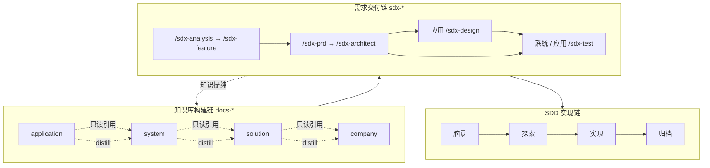

# AI Knowledge Base Framework

> **企业级元知识底座**：SSOT + 联邦治理，为 AI Agent 提供结构化知识与协作规范。

[](https://opensource.org/licenses/Apache-2.0)
[](https://github.com/oleewen/ai-knowledge/graphs/commit-activity)
[](agent/knowledge/knowledge-governance.md)

本仓提供四层知识库模板、Agent 协作资源及 Bash/Python 工具，用于在目标工程建立 SDD 协作环境。Agent 契约见 [AGENTS.md](AGENTS.md)；九章地图 [INDEX-GUIDE.md](INDEX-GUIDE.md)；目录索引 [index.md](index.md)。

---

## 简介

| 价值 | 要点 |
| --- | --- |
| SSOT | 实体按层首次定义，通过 **ID** 与规定链接引用 |
| Skills 链 | `docs-*` 构建 × `sdx-*` 交付；产物上行归并 |
| 联邦 | 公司 → 解决方案 → 系统 → 应用；link 建联与检查 / Git 更新 / distill 上行 |
| Agent 友好 | Rules + Skills；Markdown + YAML + Git |

### 为何需要

Agent = LLM + Harness。平台给模型与工具，**工程知识**须由团队以 SSOT + Skills 供给；否则知识缺失/散落/冲突/老化会逼 Agent 靠猜。本仓用契约 + 索引按需下钻，替代碰运气检索。细节与约束见 [AGENTS.md](AGENTS.md)。

---

## 四层联邦架构

| 层级 | 目录 | 职责 |
| --- | --- | --- |
| **公司** | [company/](company/README.md) | 顶层架构（VC/BD/BL）；`solution-slots/solution-{NAME}/` |
| **解决方案** | [solution/](solution/README.md) | 交付包 SLN；`system-slots/system-{NAME}/` |
| **系统** | [system/](system/README.md) | 五视角；`application-slots/application-{NAME}/` |
| **应用** | [application/](application/README.md) | 实现细节与实体 SSOT |

- **SSOT**：实体只在规定层首次定义；范围见 [INDEX-GUIDE.md §4.2](INDEX-GUIDE.md#42-聚合根知识组织)。
- **联邦**：parent 仅 `application → system → solution → company`；每个下级最多一个直接父级。公司不直管系统。
- **闭环**：knowledge ← 归档。阶段目录：公司 `domains/`；解决方案 `solutions/`；系统/应用 `analysis/` → `features/` → `requirements/`。

元模型入口：[company/DESIGN.md](company/DESIGN.md) · [solution/DESIGN.md](solution/DESIGN.md) · [system/DESIGN.md](system/DESIGN.md) · [application/DESIGN.md](application/DESIGN.md)；语义 SSOT：[knowledge-governance.md](agent/knowledge/knowledge-governance.md)。

---

## 从零选型

**口诀**：有应用仓 → bootstrap + build；有多应用 → 系统 link + Git 更新 + distill；有多系统 → 解决方案层再 hop；只有 legacy → extract → archive → build。

场景 A–D 逐步操作见 [quick-start.md](quick-start.md)。

---

## 快速开始

**预备**：Bash 5.0+、Git；索引、OKF 与校验工具需要 Python 3。推荐 `rsync`（脚本可回退 `cp`）；macOS 自带 Bash 3.2 不满足安装要求。

### 1. 手动安装（克隆后执行）

```bash
git clone https://github.com/oleewen/ai-knowledge.git
cd ai-knowledge
bash agent/skills/agent-install/scripts/agent-install.sh --agents=cursor --workspace "$HOME/workspaces" --dry-run
```

核对计划并完成 Agent 安装后，再预览知识库安装。元库和目标工程都须位于同一 `WORK_SPACE` 内；已有可用 Agent 树和工作区配置时可直接执行这一步。

```bash
bash agent/skills/docs-install/scripts/docs-install.sh --target "$HOME/workspaces/your-project/docs" --dry-run
```

### 2. 远程 Bootstrap（无需克隆）

```bash
cd "$HOME/workspaces/your-project"
curl -sL "https://raw.githubusercontent.com/oleewen/ai-knowledge/main/bootstrap.sh" | bash -s -- --doc-target "$HOME/workspaces/your-project/docs" --agents cursor,trae
```

双轨按 Agent → 知识库执行；元库保留在 `WORK_SPACE/ai-knowledge` 供后续更新。已有元库时传 `--meta PATH` 直接复用；默认目标目录已存在则停止，不覆盖。仅装 Agent 可用 `--components=agent`，仅初始化知识库可用 `--components=docs`（需已有 Agent 前置）。

### 3. Agent 自动化安装

> 根据 [ai-knowledge README](https://github.com/oleewen/ai-knowledge) 的说明，初始化知识库到当前工程 `./docs`。

技术栈与仓库元信息见 [INDEX-GUIDE.md](INDEX-GUIDE.md) §1.2。

---

## 项目结构

> 按 [INDEX-GUIDE.md §2.1](INDEX-GUIDE.md#21-模块结构) 摘录；安装入口为 [bootstrap.sh](bootstrap.sh)。

```text
./
├── README.md / AGENTS.md / INDEX-GUIDE.md / index.md / quick-start.md
├── TODO-LIST.md
├── bootstrap.sh          # agent-install → docs-install
├── company/              # knowledge/、domains/、adr/、solution-slots/
├── solution/             # knowledge/、solutions/、adr/、system-slots/
├── system/               # knowledge/、analysis/、features/、requirements/、adr/、application-slots/
├── application/          # knowledge/、analysis/、features/、requirements/、adr/
├── agent/                # knowledge/、references/、rules/、skills/、scripts/、cli/docs/、hooks/
├── docs/                 # 本地会话工作稿
├── .docsconfig           # 当前 DOC_DIR=company · KNOWLEDGE_TYPE=meta
└── .githooks/pre-commit
```

四层的 overview 均位于 `knowledge/overview/`。`docs/` 当前作为本地会话稿目录存在；`.docsconfig` 已被 Git 跟踪。配置约定见 [INDEX-GUIDE.md §7](INDEX-GUIDE.md#七配置中心configuration-hub)。

---

## Agent 工作流

`docs-*` 维护知识库，`sdx-*` 产出规约；OKF 见 `/docs-okf`。推进口径与禁止事项见 [AGENTS.md](AGENTS.md)；Skill 清单仅 [agent/skills/README.md](agent/skills/README.md)。场景分步 [quick-start.md](quick-start.md)。

公司域图使用 `/sdx-domains`，解决方案叙事使用 `/sdx-solution`；下图需求交付链面向系统/应用。DSD 属于应用详设；TDD 可面向系统或应用，缺少 DSD 时须确认仅设计 PRD 支持的业务行为用例。产物依赖见 [INDEX-GUIDE.md §5.1](INDEX-GUIDE.md#51-状态流转sdd-阶段)。



---

## 文档导航

| 需求 | 文档 |
| --- | --- |
| 从零落地（场景 A–D） | [quick-start.md](quick-start.md) |
| 九章地图 / 目录索引 | [INDEX-GUIDE.md](INDEX-GUIDE.md) · [index.md](index.md) |
| Agent 契约与查阅顺序 | [AGENTS.md](AGENTS.md) |
| 四层设计入口 | [company/DESIGN.md](company/DESIGN.md) · [solution/DESIGN.md](solution/DESIGN.md) · [system/DESIGN.md](system/DESIGN.md) · [application/DESIGN.md](application/DESIGN.md) |
| 四层语义 SSOT | [knowledge-governance.md](agent/knowledge/knowledge-governance.md) |
| 初始化脚本 | [bootstrap.sh](bootstrap.sh)、[agent/skills/docs-install/SKILL.md](agent/skills/docs-install/SKILL.md)、[agent/skills/agent-install/SKILL.md](agent/skills/agent-install/SKILL.md) |
| 共享推进契约 | [agent/references/](agent/references/) |
| 根索引完成基线 | [INDEX-GUIDE.md §8.3](INDEX-GUIDE.md#83-维护规则)（文内时间锚点） |
| OKF / Skill 清单（25） | [docs-okf/SKILL.md](agent/skills/docs-okf/SKILL.md) · [agent/skills/README.md](agent/skills/README.md) |

---

## 参与贡献

1. [INDEX-GUIDE.md](INDEX-GUIDE.md) — 路径地图  
2. [application/DESIGN.md](application/DESIGN.md)（或 company/solution/system 同名）— 层设计入口  
3. [knowledge-governance.md](agent/knowledge/knowledge-governance.md) — 四层语义、首次定义与贡献门禁  
4. [AGENTS.md](AGENTS.md) — 仓库级禁止项与查阅顺序  

**许可**：Apache-2.0（根目录暂无 `LICENSE` 文件；badge 链 OSI 条文）。
