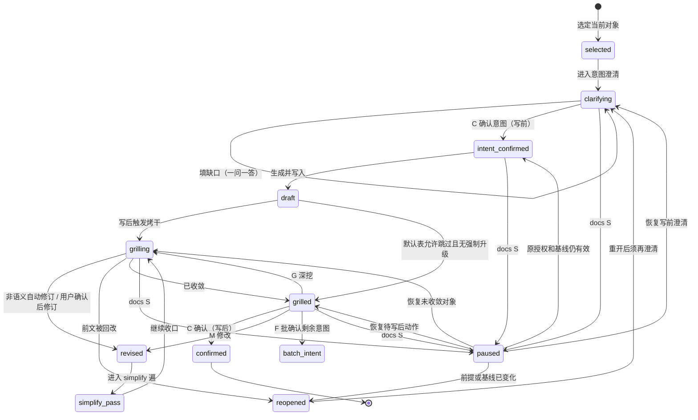

# 单元/段落推进协议（Agent SSOT）

> **定位**：跨 skill 复用的 **Section/Unit Cycle**（生成 → 烤干 → 用户动作 → 重开）唯一真源。  
> **分工**：写前 [intent-clarify.md](intent-clarify.md)；写后提问 [grilling-skill.md](grilling-skill.md)；受众质检 [audience-and-language.md](audience-and-language.md)。  
> **主线口令**：`澄清 → 生成 → 烤干`。

**最后更新**: 2026-10-23

**适用**：[workflow-routing.md](workflow-routing.md) 所列语义族；轻流程不绑。
**生成步**：生成并写入前须读 [simplify-principles.md](simplify-principles.md)（或已缓存等价要点），按其 A/B/C 落笔。用户明示「跳过精简 / 草稿优先 / 先堆素材再精简」等，仅对本轮/当前对象豁免。原则只在该契约维护。

---

## 术语

| 词 | 含义 |
| --- | --- |
| **当前段** | `sdx-*`：章节、子章节或单一设计块 |
| **当前单元** | `docs-*`：目标块、路径组、实体批次、归档块、范围确认块等 |
| **对象** | 当前段或当前单元的统称 |

本地 gates/workflow 只声明本技能用「段」还是「单元」，不复制本文协议正文。

---

## 推进总览

当前对象依次完成写前澄清、生成、按默认表烤干和用户动作；状态流转见下图，权限与重开规则见下文。

---

## 共享状态机

| 状态 | 含义 |
| --- | --- |
| `clarifying` | 写前意图澄清中；尚未授权写入 |
| `intent_confirmed` | 写前 `C` 已过 |
| `draft` | 初稿已写入目标容器 |
| `grilling` | 写后自动烤干中 |
| `simplify_pass` | 修订后按 [simplify-principles.md](simplify-principles.md) 改善本轮改动行 |
| `grilled` | 已收敛（或合法跳过烤干），待写后动作 |
| `paused` | docs 语义族暂停；保留暂停前状态与模式，不表示确认完成 |
| `revised` / `reopened` / `confirmed` | 修订中 / 须回澄清 / 写后已确认 |

---

## 写后烤干触发

各技能在本地 `workflow.md` 维护写后默认表。语义族各章节/当前单元默认必须烤干：analysis 含单个 FR；design 含 §2 内 API/DDL 块；prd 含 US/UC/AC；indexing 含 INDEX-GUIDE+LOG 输出组；build 含视角/实体批次。具体对象以本地默认表为准。

以下任一情况强制升级为必须烤干：

- 未确认决策写入正文。
- 跨段/跨单元依赖，或前文前提变更。
- 实体 ID、导航路径、索引路径变更。
- 冲突消解，或范围、目标、承诺口径变更。

启发式只可升级，不得把默认「必须」降为跳过。仅当默认表允许跳过且无强制升级时，才可直接进入 `grilled`。进入烤干须标明：**当前阶段：烤干（grilling）**。

---

## 写后完成条件（共通）

对象进入 `confirmed` 前至少：

1. 已通过写前意图澄清并完成写入（或技能允许的 dry-run 预览）
2. 已按本地**写后默认表**进入烤干（或合法跳过）
3. 烤干已收敛，或语义问题经用户确认修订后（含 simplify 遍）再次收敛
4. 烤干中须按技能本地 audience 通过 [受众质检](audience-and-language.md) **A/B/C/E**；全过静默，有违例先举证；未过不得进入 `grilled`
5. 用户在「当前阶段：烤干」下给出写后 `C`

烤干收敛后仍有未执行动作，按 [开放代办契约](todo-protocol.md) 保存；纯问答不记代办。

---

## 自动 grilling 默认授权

进入烤干后，默认仅可做**非语义性修订**（错别字、编号、排版、同对象微调）。

语义性问题（目标/范围/承诺/口径/取舍/风险/术语/路径/ID 等）必须先输出结论、推荐与数字选项；用户选择前不得修订。

- **适用**：当前对象及其直接容器内微调  
- **不适用**：前文章节、其他未打开对象、全文级结构重排（须走前文回改）

---

## simplify 遍（修订后）

`直接修订` 与 `用户确认后修订` 写入后，**不得**立刻回到烤干提问；须先跑 **simplify 遍**，再回烤干。

| 项 | 规则 |
| --- | --- |
| 做什么 | 按 [simplify-principles.md](simplify-principles.md) A/B/C，只改善**本轮修订触及的行 / hunk** |
| 不做什么 | **不**另开完整 `/docs-simplify` 技能环（无嵌套写前 `C` / 第二套 `C/M/G/S/F`） |
| 空 diff | 修订无实质 diff，或仅空白/标点 → 立即结束本遍，回烤干 |
| 豁免 | 用户明示「跳过精简 / 草稿优先」等 → 跳过本遍 |
| 次数 | **同一对象、同一烤干周期**最多 1 次 simplify 遍；本周期内再修订 → 只烤干、不再 simplify |
| `grilled` 后 | 若仍需整篇结构重组 / SSOT 去重 → 提示可开 `/docs-simplify`（独立技能单元） |

---

## 用户动作

每轮等待用户时必须打印阶段横幅：`当前阶段：意图澄清` 或 `当前阶段：烤干`。禁止无横幅裸发动作字母。

| 动作 | 阶段 | 含义 |
| --- | --- | --- |
| **C** | 意图澄清 | 确认六项清单，授权写入 |
| **C** | 烤干 | 确认当前对象，推进下一对象或收尾 |
| **M** | 两阶段 | 修改意图清单或已写正文；之后按阶段重入澄清或烤干 |
| **G** | 仅烤干 | 已收敛后追加深挖；**不是**意图澄清 |
| **F** | 烤干后 | 先批确认剩余对象意图，再连续生成（见下） |
| **S** | docs 语义族，两阶段 | **暂停**（兼容称「暂存」）：停止后续写入与推进，保留已写内容；恢复见下。`sdx-*` **无** `S` |

### `S`：暂停与恢复

`S` 不新增写入授权、不回滚已写正文、不代替写后 `C`，也不执行 Git 暂存。只停止后续动作，技能原有的原子性与失败恢复要求仍须完成。

暂停时简记当前对象、暂停前状态、正式或 dry-run 模式、已有落盘、未决项和恢复停点；不强制创建工作稿。开放代办仍按 [todo-protocol.md](todo-protocol.md) 记录。

| 暂停前 | 恢复当前对象 |
| --- | --- |
| 写前未确认 | 回意图澄清，取得写前 `C` 后才写入 |
| 已获有效写前授权，尚未执行 | 核对范围与基线后沿用原授权；不重复索要同一确认 |
| 已写入，尚未收敛 | 保留现稿，接续未完成的修订、simplify 遍或烤干；不标完成 |
| 已收敛，尚未写后确认 | 回 `grilled`，等待写后动作；裸「继续」只恢复，不自动视为 `C` |
| dry-run 预览 | 保持预览模式与原停点；转正式须按本技能取得正式写入授权 |

恢复前若范围、前提或文件基线已变，按下文重开；恢复信息不足时先核实。暂停不自动推进下一单元、不等于取消关联扩展；用户明确切换其他对象时，当前对象仍保留暂停状态。

### `F`：批量补齐前的意图批确认

1. 汇总剩余未完成对象的意图表（每行至少公共六项摘要）。
2. 用户一次确认（写前语境 `C`）后才连续生成。
3. 批确认后，对象间不再单独停意图澄清；每对象写入后仍按默认表 + 强制升级烤干。
4. 烤干遇语义问题或前文回改：立即停下；回改后受影响对象 `reopened` → 回意图澄清。

`F` 不是整篇重生成，不覆盖已确认前文，不得跳过剩余意图批确认。

### 整体验证（`F` 或全部对象完成后）

至少检查：跨对象矛盾、编号连续、术语一致、frontmatter/约定元数据、与已确认前文自洽。重大问题可重开对应对象。

---

## 前文回改与重开

涉及前文设定错误、范围漂移、目标/术语冲突等时：

1. 先给受影响前提、推荐方案、数字选项；确认前不执行回改。
2. 回改后：当前对象 → `reopened` → 必须回到意图澄清 → 写前 `C` → 修订/重写 → 再烤干。
3. **前文回改 ≠ 当前对象自动通过**。

导致重开：前文被改且影响前提；`M` 后未再收敛；用户显式重审；`F` 过程中后续对象打穿前提。

重开后：不得沿用旧 `confirmed`；须重新完成「澄清 → 生成/修订 → 烤干 → 用户动作」。

---

## 技能 Binding 要求

本地 `gates.md` / `workflow.md` **只保留**：

1. 链到本文 + [intent-clarify.md](intent-clarify.md) + [grilling-skill.md](grilling-skill.md)（不复制全文）
2. 对象定义（段 vs 单元）与产物路径
3. **写后默认表**（建议只写在 `workflow.md`）
4. 技能追加澄清字段、语义问题清单、高风险场景、失败停顿/原子性
5. 参数向导与脚本/I-O（`workflow.md`）

启用本协议的技能须同步 SKILL.md / evals 中相关推进断言（若有）。本地不得删减写前公共六项，也不得复制共享状态机、动作字母全文、`F` 批确认细则或共通 mermaid 环。
