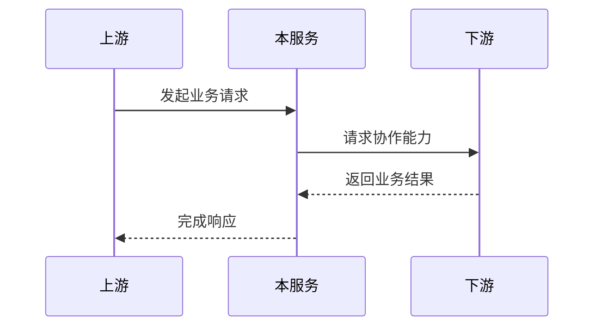
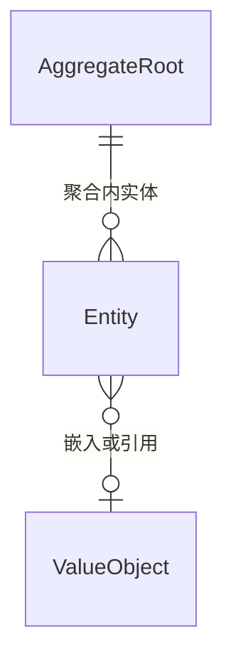

# {架构设计说明书（ASD）标题}

> 读者：**架构师**（主笔与验收）；**分析、产品、研发**参评可行性与范围。
> 写法：系统架构、接口协议、领域模型、数据架构、发布方案，不写内部调用细节。
> 本模板用于系统/应用库；示意内容须替换为已核实方案。系统库按联邦概要粒度填写。

---

## 1. 设计概述

### 1.1 设计目标

- 关联产品需求：`./PRD-{IDEA-ID}-{N}.md`
- 关联需求分析（可选，读取后填写）：`../../../analysis/ANALYSIS-{IDEA-ID}.md`
- MVP阶段：MVP-Phase-{N}
- 设计目标：{本阶段要达成的架构结果及对应需求 ID}

### 1.2 设计约束
<!-- 技术/架构/兼容约束 -->

### 1.3 关键设计决策

| 决策编号 | 决策点 | 决策结果 | 决策理由 | 备选方案 |
| --------- | ------- | --------- | --------- | --------- |
| DD-001 | {决策点} | {已确认结果} | {约束与依据} | {真实备选及取舍} |

## 2. 架构设计

### 2.1 系统架构设计

#### 系统架构图

#### 服务变更

| 服务名称  | 所属应用   | 变更类型 | 变更说明    |
| ----------- | ------------ | ---------- | ------------- |
| {服务名称} | {所属应用} | {新增/变更/移除} | {职责与影响} |

#### 服务交互

### 2.2 接口协议设计

| 接口名称 | 所属服务 | 能力说明 | 输入输出 |
| --------------- | -------- | -------- | ------ |
| {接口名称} | {所属服务} | {协议级能力与责任} | {输入输出摘要；字段详设见 DSD} |

### 2.3 领域模型设计

#### 领域模型图

#### 领域事件

| 事件名称        | 触发条件 | 携带数据 | 消费者 |
| --------------- | -------- | -------- | ------ |
| {事件名称} | {业务触发条件} | {关键业务信息} | {消费者} |

### 2.4 数据架构设计

#### 数据存储选型

| 数据与访问模式 | 已核实约束 | 存储选择 | 理由与代价 |
| --- | --- | --- | --- |
| {数据类别、读写模式} | {规模、事务、一致性等依据} | {已确认方案} | {备选取舍；未知项标待确认} |

#### 数据库表设计

<!-- 仅列逻辑数据关系、归属和变更影响；物理字段、索引与 DDL 交由 DSD。 -->

#### 数据分片设计

<!-- 按实际需求写分片边界与理由；无需分片时说明依据。 -->

#### 数据迁移方案

<!-- 迁移范围、一致性约束、验证及回退条件；执行脚本留给下游。 -->

### 2.5 发布方案设计

#### 发布步骤

<!-- 部署与环境变更：逐项（升级/迁移/配置/切换等）-->

#### 发布检查

- 变更窗口、影响面和依赖已确认
- 迁移验证、三方/全链路验证有承接方
- 回滚条件、责任人与兜底方案已明确

#### 回滚方案

<!-- 记录回滚触发、数据/配置保护、执行边界和恢复验收；不能假定所有变更都能逆向操作。 -->

## 3. 需求规约

### 3.1 需求规约摘要

<!-- 摘要足以评审能力边界、需求 ID 和协议口径；实现正文交由应用库 DSD。 -->
<!-- `{app-name}` 使用 a-z0-9._-，对齐 knowledge-links.yaml。以下相对路径以本模板约定的 MVP-Phase 目录为起点。 -->
<!-- 写入终稿时，将已核实存在的 PRD/规约路径转为可点链接；模板占位与待建路径不伪装成有效链接。 -->

| 应用 | 规约文件 | 规约描述 |
| ---- | -------- | -------- |
| `{APP-ID}` | `../../../specs/spec-asd-{IDEA-ID}-{N}-{app-name}.md` | {能力边界、覆盖需求 ID、关键协议约束} |

<!-- 不生成独立 spec 时，在“规约文件”列标“不单列”，保留摘要及下游 DSD 承接；拟建文件须标“待建”，不得伪装成已存在链接。 -->

下游承接：{负责应用及 DSD 路径/待建状态}。
