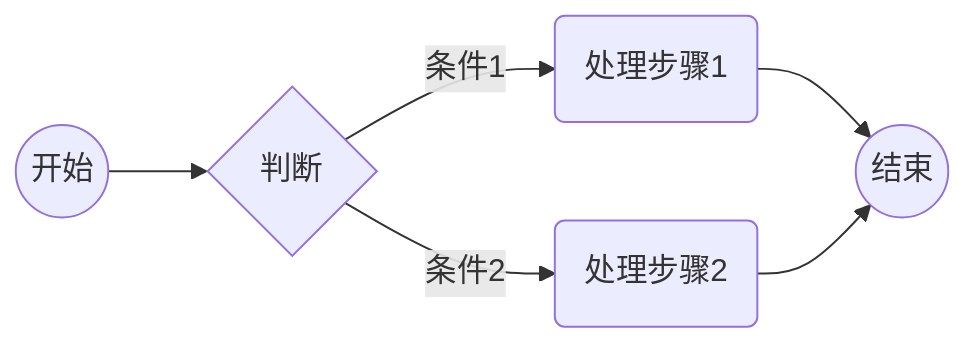
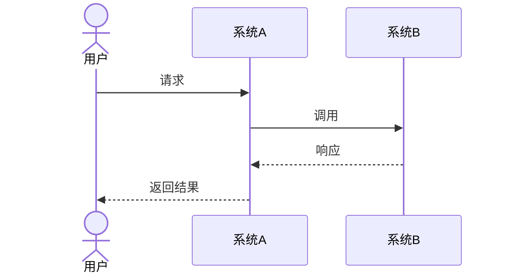
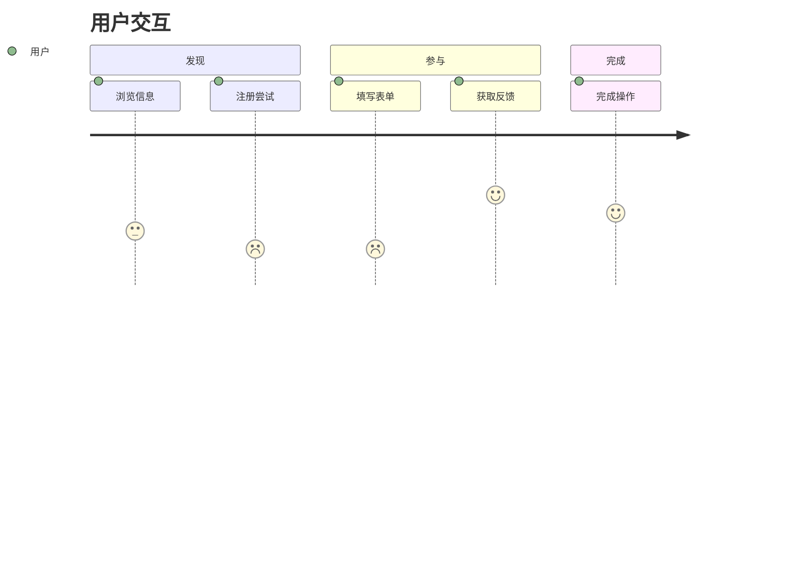
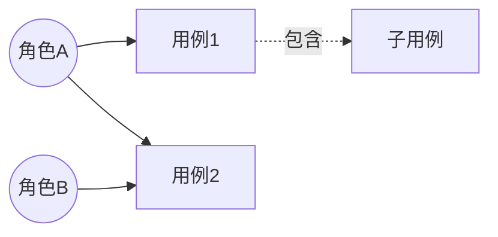
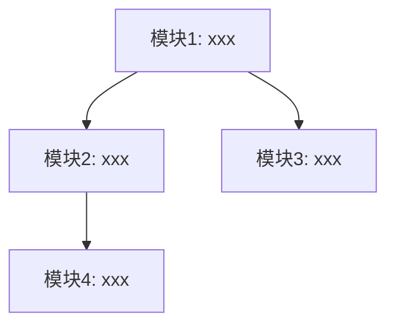

<!-- markdownlint-disable-next-line MD025 -->
# 产品需求标题

> 读者：**产品**（主笔与验收）；**分析、架构、研发**参评可行性与范围。
> 写法：用户故事、用例、流程、验收等，不写内部调用细节。

---

## 1. 产品概述

### 1.1 产品目标

- 关联功能特性：`{DOC_DIR}/features/FEATURE-{IDEA-ID}.md`
- 背景依据：{已核实的 ANALYSIS / SOLUTION 路径或 ID；无关联材料时说明缺口，不推造路径}
- MVP阶段：MVP-Phase-{N}

### 1.2 成功标准

| 成功维度 | 指标/目标 | 数据来源（FEATURE / 背景依据） | 备注  |
| ---- | ----- | ---------------- | --- |
|      |       |                  |     |

### 1.3 需求范围

#### 本 MVP 范围

#### 后续阶段（Growth / Vision）

| 阶段          | 范围概要 | 计划/依赖说明 |
| ----------- | ---- | ------- |
| Growth（增长期） |      |         |
| Vision（愿景）  |      |         |

### 1.4 涉及角色

| 角色  | 描述  | 相关用例 |
| --- | --- | ---- |
|     |     |      |

## 2. 业务流程

### 2.1 核心业务流程



#### 流程步骤说明

| 步骤  | 参与角色 | 输入  | 处理逻辑 | 输出  | 业务规则   |
| --- | ---- | --- | ---- | --- | ------ |
| 1   |      |     |      |     | BR-xxx |

### 2.2 分支异常流程

#### 异常场景清单

| 异常编号 | 关联步骤 | 异常描述 | 触发条件 | 处理方式 | 用户提示 |
| --- | --- | --- | --- | --- | --- |
| EX-001 | | | | | |

### 2.3 系统交互流程



## 3. 产品交互

### 3.1 用户交互流程



### 3.2 产品交互设计

交互原型：{已核实的原型链接；暂无则标「待补充」或「不适用」并说明理由}

| 交互场景 | 交互方式/控件 | 反馈与提示 | 备注  |
| ---- | ------- | ----- | --- |
|      |         |       |     |

## 4. 用例模型

### 4.1 用例图



### 4.2 用例详述

#### UC-001: {用例名称}

| 项目       | 描述     |
| -------- | ------ |
| **用例编号** | UC-001 |
| **用例名称** |        |
| **参与者**  |        |
| **触发条件** |        |
| **前置条件** |        |
| **处理步骤** |        |
| **后置条件** |        |
| **异常场景** |        |
| **关联故事** | US-001 |

**业务规则**：

- BR-xxx（规则正文见 §7）

## 5. 用户故事

### 5.1 用户故事清单

| 故事编号 | 用户故事 | 优先级 | 故事点 | 关联需求 | 关联用例 |
| --- | --- | --- | --- | --- | --- |
| US-001 | 作为{角色}，我希望{功能}，以便{价值} | P0 | | FR-001 | UC-001 |

### 5.2 用户故事详述

#### US-001: {故事标题}

**用户故事**：

> 作为{角色}，我希望{功能}，以便{价值}

**验收标准**：

```gherkin
场景1: {场景名称}
  假设 {前置条件}
  当 {触发动作}
  那么 {预期结果}

场景2: {异常场景名称}
  假设 {前置条件}
  当 {触发动作}
  那么 {预期结果}
```

**补充说明**：

- 业务规则：BR-xxx
- 关联需求 / 用例：FR-001 / UC-001
- 界面要求：（如有）
- 性能要求：（如有）

## 6. 功能模块设计

### 6.1 功能模块划分



### 6.2 模块详述

#### 模块1: {模块名称}

- **职责**：
- **包含功能**：US-001, US-002
- **输入**：
- **输出**：
- **依赖模块**：

## 7. 业务规则汇总

| 规则编号   | 规则名称 | 触发条件 | 执行逻辑 | 异常处理 | 优先级 | 关联用例   |
| ------ | ---- | ---- | ---- | ---- | --- | ------ |
| BR-001 |      |      |      |      |     | UC-001 |

## 8. 数据字典

### 8.1 业务术语

| 术语  | 定义  | 示例  | 备注  |
| --- | --- | --- | --- |
|     |     |     |     |

**业务字段**（业务语义，不写数据库设计；无适用字段时说明理由）：

| 字段 | 含义 | 类型 | 必填 | 枚举/约束 |
| --- | --- | --- | --- | --- |
| | | | | |

### 8.2 状态定义

| 实体 | 状态 | 说明 | 可流转状态 | 是否终态 | 非法转换处理 |
| --- | --- | --- | --- | --- | --- |
| | | | | | |

## 9. 非功能需求

可参考类别（按需勾选，不适用项删行或标「不适用」）：性能、可靠性、可用性、安全、合规、可观测性、兼容性、可维护性、容量、易用性等。

| 类别 | 指标名 | 是否适用 | 指标/阈值 | 度量方法 | 上游依据 |
| --- | --- | --- | --- | --- | --- |
| | | | | | |

## 10. 验收标准

### 10.1 功能验收标准（FAC）

| 编号     | 验收项 | 验收条件 | 关联故事   |
| ------ | --- | ---- | ------ |
| AC-001 |     |      | US-001 |

### 10.2 非功能验收标准（NAC）

| 编号      | 验收项 | 验收条件 | 关联 NFR（§9） |
| ------- | --- | ---- | ---------- |
| NAC-001 |     |      |            |

## 11. 附录

### 11.1 原型/线框图

### 11.2 变更历史

| 版本    | 日期  | 变更说明 | 作者               |
| ----- | --- | ---- | ---------------- |
| 1.0.0 |     | 初始版本 | product-designer |

### 11.3 质量自查表 (Self-Check)

<!-- 本节为逐章验收标准真源。生成或重写本节时保留全部条目及标准正文，只更新勾选；检查结论与证据另附其后。任一必需条件待补充、待澄清或未检查，整项保持未勾选；不适用须有理由。结构校验不能替代以下语义验收。 -->

- [ ] **结构与占位**：§1–§11 及必需小节齐全；无未标注空章；适用的流程、用例等 Mermaid 图可渲染。占位仅说明进度，不代表对应章节完成。
- [ ] **§1 产品概述**：引用已共识 FEATURE；背景 ANALYSIS / SOLUTION 按实际关联填写。目标、成功指标、MVP-Phase-{N} 与 FEATURE 一致；后续 Growth/Vision 范围已说明或标不适用；角色与 §4 一致。
- [ ] **§2 业务流程**：主流程步骤表六要素完整；EX-n 有关联步骤、触发与处理；涉及跨系统时说明边界、同步/异步和关键输入输出，否则标不适用。
- [ ] **§3 产品交互**：覆盖核心任务、反馈与校验；原型链接已核实，缺失时有文字说明，不能用占位 URL 充作证据。
- [ ] **§4 用例模型**：图覆盖 §1.4 业务角色；每个 UC-n 含前后置、主成功与扩展场景，并与 US-n 双向映射。
- [ ] **§5 用户故事**：当前 MVP 的每个 FR-n 至少对应一个可独立演示的 US-n；每故事有正常与异常/边界 GWT，关联 FR/BR/UC；优先级与 FEATURE 无未说明冲突。
- [ ] **§6 功能模块设计**：按业务能力域划分并映射 US-n，无孤立模块或故事。
- [ ] **§7 业务规则汇总**：BR-n 字段完整、编号无冲突，与 §2/§5 引用及上游一致；互斥规则有优先级和化解策略。
- [ ] **§8 数据字典**：术语和业务字段含义、类型、必填、枚举清楚；状态、终态、合法流转与非法转换处理对齐流程，不适用项有理由。
- [ ] **§9 非功能需求与 §10 验收**：NFR 仅覆盖本 MVP，指标与度量已确定；AC-n 可测并关联 US-n；NAC-n 对应 §9 指标或说明不适用。待澄清阈值不能视为通过。
- [ ] **业务可读（语言）**：§1–§10 以产品行为与业务结果为主，不以接口、表字段或中间件为验收依据；必要工程线索集中 §11.1 备注或标待研发确认。
- [ ] **一致性**：与 parent 对应 FEATURE、已引用背景及 knowledge 的目标、范围和 MVP 无未解释冲突；缺失背景或基线盲区明确列出。
- [ ] **可追溯**：US→FR、UC↔US、BR 与 FEATURE 同链；AC/NAC 可指回 US 或 §9；EX 可指回流程步骤；既有编号未被擅自重排。
- [ ] **术语与引用**：§8.1 术语、§11.2 变更历史已落位；外部链接可访问，或标待补并说明影响。
- [ ] **格式与元数据**：必需 frontmatter 字段齐全；id=PRD-{IDEA-ID}-{N}、parent=FEATURE-{IDEA-ID}、mvp_phase=MVP-Phase-{N}，与文件名及 REQUIREMENT/MVP-Phase 目录一致。
