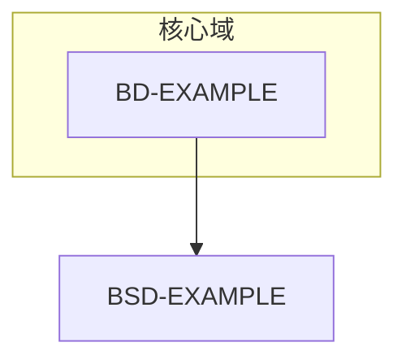

# 业务域划分

[返回 · 业务架构](../README.md)

**结论**：公司级 BD 与 BSD-L1 按价值链与能力定界。能力见 [业务能力](business-capability.md)；价值链见 [价值链](business-value-chain.md)。

域分类与入口在本章维护；职责、边界与能力映射以各 `BD-*.md`、`BSD-*.md` 与 `CAP-*.md` 为准。

## 域分类与入口

核心域直接实现价值环节，支撑域横跨价值环节提供支撑，通用域承载跨业务复用能力。下表仅演示现有实体；子域数按各类业务域下已登记的公司级 BSD-L1 去重统计。

| 域类型 | 业务域 | 子域数 | 能力入口 |
|--------|--------|-------:|----------|
| 核心域 | [BD-EXAMPLE](../BD/BD-EXAMPLE/BD-EXAMPLE.md) | 1 | [业务子域](../BD/BD-EXAMPLE/index.md) · [业务能力](business-capability.md) |
| 支撑域 | —（示例未登记） | 0 | — |
| 通用域 | —（示例未登记） | 0 | — |

通用域按业务需要明确自建、外购或集成方式；已确认的建设约束写入对应实体，技术平台登记见[技术架构](../../technical/README.md)。

## 业务子域

| 业务域 | 业务子域 | 职责 | 边界 | 能力 |
|---|---|---|---|---|
| [BD-EXAMPLE](../BD/BD-EXAMPLE/BD-EXAMPLE.md) | [BSD-EXAMPLE](../BD/BD-EXAMPLE/BSD-EXAMPLE.md) | 对标 CAP-EXAMPLE | 挂在 BD-EXAMPLE 下 | [CAP-EXAMPLE](../VC-EXAMPLE/CAP/CAP-EXAMPLE.md) |

业务子域从各 `BD-*/index.md` 下钻；域与能力映射见各 `BSD-*.md` 与 `CAP-*.md`，汇总冲突以实体正文为准。

## 业务域关系图

