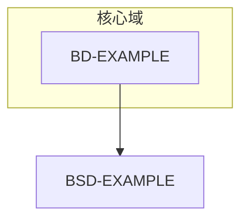

# 业务域划分

[返回 · 业务架构](../README.md)

**结论**：公司级 BD 与 BSD-L1 按价值链与能力定界。能力见 [业务能力](business-capability.md)；价值链见 [价值链](business-value-chain.md)。

## 核心域

直接实现价值环节的一级域。本示例仅 BD-EXAMPLE。

| 业务域 | 职责 | 边界 | 能力 |
|---|---|---|---|
| [BD-EXAMPLE](../BD/BD-EXAMPLE/BD-EXAMPLE.md) | 支撑 [VC-EXAMPLE](../VC-EXAMPLE/VC-EXAMPLE.md) | 下挂 BSD-EXAMPLE | [CAP-EXAMPLE](../VC-EXAMPLE/CAP/CAP-EXAMPLE.md) |

## 支撑域

横跨价值环节的一级域。本示例无支撑域。

| 业务域 | 职责 | 边界 | 能力 |
|---|---|---|---|

## 通用域

跨业务复用的一级域。本示例无通用域。

| 业务域 | 职责 | 边界 | 能力 |
|---|---|---|---|

## 业务子域

| 业务域 | 业务子域 | 职责 | 边界 | 能力 |
|---|---|---|---|---|
| [BD-EXAMPLE](../BD/BD-EXAMPLE/BD-EXAMPLE.md) | [BSD-EXAMPLE](../BD/BD-EXAMPLE/BSD-EXAMPLE.md) | 对标 CAP-EXAMPLE | 挂在 BD-EXAMPLE 下 | [CAP-EXAMPLE](../VC-EXAMPLE/CAP/CAP-EXAMPLE.md) |

## 业务域关系图

