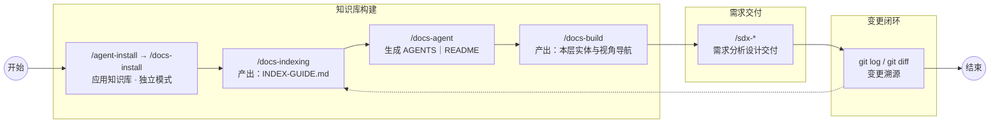
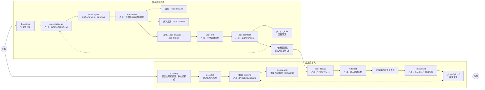
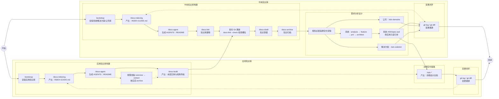
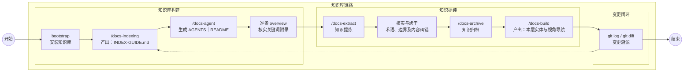

# 从零起步构建知识库

> **定位**：落地操作指南；执行规则以各技能及共享协议为准。概念见 [README.md](README.md)；元模型见 [knowledge-governance](agent/knowledge/knowledge-governance.md)。

---

## 选型

**口诀**（与 [README 从零选型](README.md#从零选型) 同口径）：有应用仓 → bootstrap + build；有多应用 → 系统 link + Git 更新 + distill；有多系统 → 解决方案层再 hop；只有 legacy → extract → archive → build。

| 场景 | 适用 | 一句话 |
| --- | --- | --- |
| **A** | 单一应用，无联邦 | 应用仓 standalone，建 SSOT + 按需 SDD（含 `/sdx-analysis`） |
| **B** | 新交付（多应用）+ 上层业务知识库 | 先解决方案/系统需求与概设，再应用库详设 |
| **C** | 老系统（多应用）+ 上层业务知识库 | 先各应用 SSOT，再三跳 link/distill/archive |
| **D** | 仅有 Wiki/协作文档等 legacy | overview 缓冲区 → archive → build |

脚本参数与 mode 见 [agent/skills/docs-install/SKILL.md](agent/skills/docs-install/SKILL.md)；双轨自动化见 [bootstrap.sh](bootstrap.sh)。全新环境先安装 Agent 并配置 `WORK_SPACE`，再初始化知识库；已有 Agent 前置时可直接初始化。bootstrap 的 `--meta PATH` 可复用已有元库，未指定时将元库保留在 `WORK_SPACE/ai-knowledge`。

产物分工：[docs-indexing](agent/skills/docs-indexing/SKILL.md) 管九章 `INDEX-GUIDE.md` 与文内增量锚点；[docs-build](agent/skills/docs-build/SKILL.md) 管本层首次定义实体、视角 README 与 INDEX 第四章导航；目录 `index.md` 和 `viz.html` 按需由 [docs-okf](agent/skills/docs-okf/SKILL.md) 刷新。下文 `/docs` 为示例，实际路径以 `.docsconfig` 的 `DOC_DIR` 为准。

---

## 场景 A：独立应用系统

**目标**：单一应用仓建 SSOT，无需系统/解决方案/公司联邦。

| 步骤 | 动作 | 产出 |
| --- | --- | --- |
| 1 | 先满足 `/agent-install` 前置，再 `/docs-install`（`--mode=standalone`，`--type=application`） | 应用 `/docs` 骨架 + `.docsconfig` + Agent |
| 2 | `/docs-indexing`（完成 spec 与 gate 确认）+ `/docs-agent` | `INDEX-GUIDE.md`、`README.md`、`AGENTS.md` |
| 3 | `/docs-build` | 本层实体、视角 README、INDEX 第四章导航 |
| 4 | 需求交付按需：`/sdx-analysis` → `/sdx-feature` → `/sdx-prd` → `/sdx-architect` → `/sdx-design` → `/sdx-test` | `ANALYSIS` / `FEATURE` / `PRD` / `ASD` / `DSD` / `TDD` |
| 5 | `git log` / `git diff` + 定期 `/docs-indexing` | 变更可追溯 |

---

## 场景 B：新交付（多应用）+ 中央知识库

**目标**：公司 `domains/`、解决方案 `solutions/`、系统 `analysis/`→`features/`→`requirements/` 分层写；应用库承接详设。七章需求分析由 `/sdx-analysis` 写在系统/应用。

### 阶段一：上层业务知识库 — 分层需求分析设计

| 步骤 | 动作 | 产出 |
| --- | --- | --- |
| 1 | 先满足 Agent 前置，再 `/docs-install` 按层 `--type=company` / `solution` / `system` | `/docs` 骨架 + `.docsconfig` |
| 2 | `/docs-indexing` + `/docs-agent`，再 `/docs-build` | 九章地图、根入口、本层实体与视角导航 |
| 3 | 公司：`/sdx-domains`。解决方案：`/sdx-solution`。系统/应用：`/sdx-analysis` → `/sdx-feature` → `/sdx-prd` → `/sdx-architect` | `DOMAIN-*` / `SOLUTION` / `ANALYSIS` / `FEATURE` / `PRD` / `ASD` |

系统分析可从原始需求开始，不以 SOLUTION 为前置。公司、解决方案、系统在各自知识库执行上述分支。

### 阶段二：应用库 — 引用概设、详设与开发

| 步骤 | 动作 | 产出 |
| --- | --- | --- |
| 1 | 先满足 Agent 前置，再 `/docs-install` 安装应用库，随后 `/docs-link`（系统→应用） | 应用 `/docs` + `application-slots` |
| 2 | `/docs-indexing` + `/docs-agent` 后，按 [只读消费契约](agent/skills/sdx-design/references/central-spec-source.md) 定位并确认中央 ASD/spec-asd | HTTP 来源链接与确认内容基线 |
| 3 | 规约详细设计链路：`/sdx-design` → `/sdx-test` | `DSD`、`TDD` |
| 4 | 使用当前工程已安装并确认的实现工作流 | 代码实现 + 规格归档 |
| 5 | `/docs-build`（按需） | 本层实体、视角 README、INDEX 第四章导航 |

应用库 **mode**：**standalone** = 单应用全量模板；**central** = 仅同步 `knowledge/` 等子集并 `docs-link` 建联（见 [agent/skills/docs-install/SKILL.md](agent/skills/docs-install/SKILL.md)）。

### 阶段三：变更溯源与索引

| 步骤 | 动作 | 产出 |
| --- | --- | --- |
| 1 | `git log` / `git diff` | 变更历史（仓内 commit） |
| 2 | `/docs-indexing`（增量，完成 gate 确认） | `INDEX-GUIDE.md` 与文内增量锚点对齐、可追溯 |

---

## 场景 C：老系统（多应用）+ 中央知识库

**目标**：先各应用落地 SSOT，再按 `application → system → solution → company` 上行聚合，再接分层 SDD。

### 阶段一：现存应用构建知识库

| 步骤 | 动作 | 产出 |
| --- | --- | --- |
| 1 | 先满足 Agent 前置，再为各应用 `/docs-install`（`--mode=standalone` 或 `central`） | 应用 `/docs` 骨架 + `.docsconfig` + Agent |
| 2 | `/docs-indexing`（完成 spec 与 gate 确认）+ `/docs-agent` | `INDEX-GUIDE.md`、`README.md`、`AGENTS.md` |
| 3 | 按需从 legacy 源 `/docs-extract`，核实后 `/docs-archive`；overview 前置见场景 D | overview 第三列 delta 与已归档章节 |
| 4 | `/docs-build` | 各应用本层实体、视角 README、INDEX 第四章导航 |
| 5 | `git log` / `git diff` | 各应用仓变更历史 |

### 阶段二：上层业务知识库 — 三跳登记、检查、蒸馏、归档

| 步骤 | 动作 | 产出 |
| --- | --- | --- |
| 1 | 先满足 Agent 前置，再 `/docs-install` `--type=system` / `solution` / `company` | 各层 `/docs` + `.docsconfig` |
| 2 | `/docs-indexing` + `/docs-agent` | 各层索引入口 |
| 3 | `/docs-link`：系统←应用、解决方案←系统、公司←解决方案 | `knowledge-links.yaml` + 对应槽位 |
| 4 | 各下级仓按普通 Git 工作流更新；`/docs-link --check`，异常槽位用 `--repair --target <已登记路径或URL>` | 本地内容已核实、槽位可达 |
| 5 | 在系统、解决方案、公司目标仓逐跳 `/docs-distill`；按各仓实际 DOC_DIR、知识层与源名称执行，见 [工作流](agent/skills/docs-distill/references/workflow.md) | 各层 `{NAME}-overview.md` 第三列 |
| 6 | `/docs-archive`（核实后） | 落入该层 `knowledge/` 视角章节 |

### 阶段三：分层需求分析、概要设计

| 步骤 | 动作 | 产出 |
| --- | --- | --- |
| 1 | 解决方案 `/sdx-solution`；系统/应用 `/sdx-analysis` → `/sdx-feature` → `/sdx-prd` → `/sdx-architect`；公司仅 `/sdx-domains` | `SOLUTION` / `ANALYSIS` / `FEATURE` / `PRD` / `ASD` / `DOMAIN-*` |

### 阶段四：应用库详设、开发与变更

| 步骤 | 动作 | 产出 |
| --- | --- | --- |
| 1 | 按 [只读消费契约](agent/skills/sdx-design/references/central-spec-source.md) 确认各应用的中央规约来源 | HTTP 来源链接与确认内容基线 |
| 2 | 规约详细设计链路：`/sdx-design` → `/sdx-test` | `DSD`、`TDD` |
| 3 | 使用当前工程已安装并确认的实现工作流 | 代码实现 + 规格归档 |
| 4 | 各仓 Git 更新与溯源 + `/docs-link --check` + 三跳 `/docs-distill` | 联邦镜像与各层 overview 全量对齐 |
| 5 | `/docs-indexing`（增量，完成 gate 确认） | 各库 `INDEX-GUIDE.md` 与文内增量锚点更新 |

---

## 场景 D：从现存文档抽取结构化知识库

**目标**：仅有 Wiki / 协作文档等 legacy；overview 作缓冲区，再抽成 SSOT。

### 阶段一：安装、盘点源、写入 overview

| 步骤 | 动作 | 产出 |
| --- | --- | --- |
| 1 | 先满足 Agent 前置，再 `/docs-install` 按实际知识层初始化 | `/docs` 骨架 + `.docsconfig` + Agent |
| 2 | `/docs-indexing`（完成 spec 与 gate 确认）+ `/docs-agent` | `INDEX-GUIDE.md`、`README.md`、`AGENTS.md` |
| 3 | 复制该层 overview 模板为 `{NAME}-overview.md`，核实关键词附录；缺失时先 `/docs-tag` | overview 骨架与关键词附录 |
| 4 | `/docs-extract` 段落筛选提炼入第三列 | overview 第三列草稿 |

### 阶段二：核实归档与实体

| 步骤 | 动作 | 产出 |
| --- | --- | --- |
| 1 | 人工核实高优先级行（先术语与边界，再流程与接口） | 可归档条目 |
| 2 | `/docs-archive` | 知识落入该层 `knowledge/{perspective}/chapters/`（应用 / 系统 / 解决方案 / 公司） |
| 3 | `/docs-build` | 本层实体、视角 README、INDEX 第四章导航 |

> **原则**：overview → archive → entity，勿一步硬造 YAML。约定见 [knowledge-governance](agent/knowledge/knowledge-governance.md)、[knowledge-layout](agent/references/knowledge-layout.md)。

### 阶段三：变更溯源与按需需求交付

| 步骤 | 动作 | 产出 |
| --- | --- | --- |
| 1 | `git log` / `git diff` | 变更历史（仓内 commit） |
| 2 | `/docs-indexing`（增量，完成 gate 确认） | `INDEX-GUIDE.md` 与文内增量锚点对齐 |
| 3 | 按层交付：解决方案 `/sdx-solution`；系统/应用 `/sdx-analysis` → `/sdx-feature` → … → `/sdx-test`；公司 `/sdx-domains` | 对应阶段文档 |

---

## 相关文档

| 需求 | 文档 |
| --- | --- |
| 流程总览图 | [README.md — Agent 工作流](README.md#agent-工作流) |
| 元模型与实体层级 | [knowledge-governance.md](agent/knowledge/knowledge-governance.md) |
| 初始化脚本 | [bootstrap.sh](bootstrap.sh)、[agent/skills/README.md](agent/skills/README.md) |
| Skill 清单 | [agent/skills/README.md](agent/skills/README.md) |
